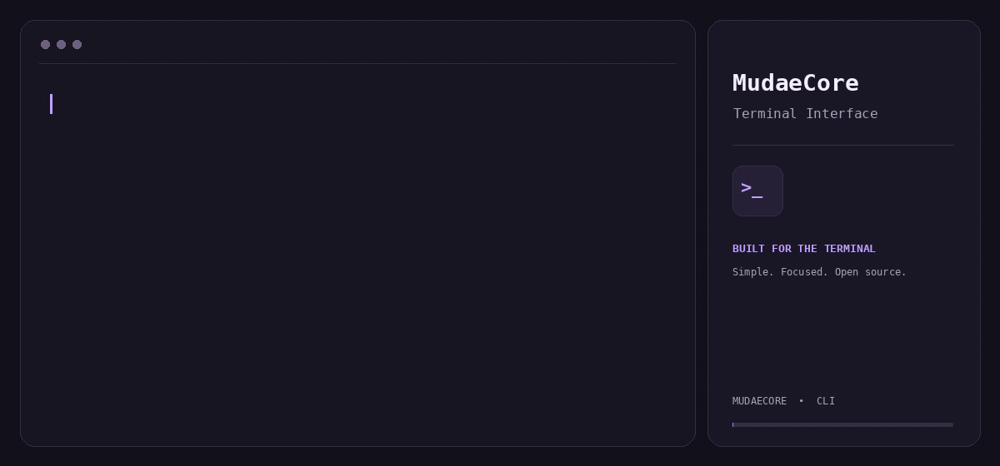

<div align="center">

# 


*Character Tracking · Kakera Management · Wishlist Support · Custom Presets*

[](https://www.python.org/)


[](https://github.com/wintercraxker/MudaeCore/stargazers)
</div>

---

## 〢 💭 What is MudaeCore?

**MudaeCore** is an automated Mudae companion for Discord, designed to help users organize character preferences, monitor rolls and claim availability, track Kakera-related activity, and manage multiple configuration profiles.

It brings together character and series wishlists, configurable thresholds, independent presets, terminal menus, and activity monitoring.

> **Disclaimer:** MudaeCore is an independent community project and is not affiliated with, endorsed by, or officially authorized by Discord or Mudae. Automated user accounts may violate Discord's Terms of Service.

## 〢 ✨ Features

- **Character Tracking** — Monitor character-related activity and preferences.
- **Kakera Management** — Configure Kakera thresholds and review related activity.
- **Roll Monitoring** — View available rolls and reset information.
- **Wishlist Support** — Organize preferred characters and series.
- **Custom Presets** — Maintain independent configuration profiles.
- **Multiple Profiles** — Manage different profiles from the terminal menu.
- **Activity Logs** — Follow events through organized, terminal-formatted messages.
- **Multilingual Interface** — English, Spanish, and Brazilian Portuguese support.

## 〢 📋 Requirements

- **Python:** Python 3.14 was used and checked for this repository. Compatibility with older or newer Python releases has not been established.
- **Operating systems:** The code contains Windows console support and Linux/POSIX fallbacks. Windows and Linux usage have not both received manual compatibility verification.
- **Terminal:** A terminal capable of interactive keyboard input and UTF-8 output is required. ANSI color support is optional.
- **Python packages:** `discord.py` and `inquirer` are imported directly. Their dependencies must be installed with them.
- **Required project files:** `bot.py`, `mudaecore/`, `assets/`, and `locales/`. Runtime configuration is read from `presets.json`.

## 〢 📦 Installation

### Windows — Recommended

1. Download or clone the repository from [MudaeCore on GitHub](https://github.com/wintercraxker/MudaeCore).
2. Extract the downloaded ZIP, or enter the cloned project folder.
3. Run `install.bat`.
4. Wait until the installer reports successful verification.
5. Run `start.bat` to launch MudaeCore.

The Windows installer creates `.venv` inside the project directory and installs `requirements.txt` without administrator permissions. It does not install Python or launch the application automatically.

### Manual Installation

Clone the repository, enter the project directory, and create a virtual environment:

```powershell
git clone https://github.com/wintercraxker/MudaeCore.git
cd MudaeCore
python -m venv .venv
.venv\Scripts\activate
python -m pip install -r requirements.txt
python bot.py
```

On Linux or macOS, use the environment activation command for your shell:

```bash
python3 -m venv .venv
source .venv/bin/activate
python -m pip install -r requirements.txt
python bot.py
```

## 〢 🚀 Getting Started

On Windows, start MudaeCore with `start.bat`, or run `python bot.py` manually from the activated environment.

The general flow is:

1. MudaeCore starts and asks you to select English, Spanish, or Brazilian Portuguese.
2. The main menu appears.
3. Open **Configuration**.
4. Create a new preset or select an existing one.
5. Configure preferences, wishlists, numeric values, and boolean options.
6. Save the changes.
7. Return to the main menu and use the available start options.

The preset credential prompt is optional. A preset without a valid credential or token is not started.

## 〢 ⚙️ Configuration

Configuration is handled locally in the terminal through `mudaecore/config_editor.py`. The editor validates values and writes `presets.json` atomically. It does not add Discord or Mudae actions.

The editor supports:

- Creating presets
- Editing existing presets
- Renaming presets
- Managing character and series wishlists
- Editing numeric values
- Activating or deactivating boolean options
- Saving or discarding pending changes
- Cancelling an edit or preset creation

| Field | Purpose |
| --- | --- |
| `roll_command` | Roll command value used by the preset, such as `wa` or `ha`. Custom values must match the local validation format. |
| `min_kakera` | Minimum Kakera value used by the preset's claim logic. |
| `wishlist` | Character names used by the preset's character selection and Auto Steal features. |
| `series_wishlist` | Series names kept separately from character wishlist entries. |
| `snipe_mode` | Character selection associated with the configured character wishlist. |
| `kakera_snipe_mode` | Character selection based on Kakera value and `kakera_snipe_threshold`. |
| `kakera_snipe_threshold` | Threshold used with Kakera-value selection. |
| `kakera_reaction_snipe_mode` | Enables the preset's configured Kakera reaction feature. |
| `auto_pokeslot` | Enables the periodic Pokeslot feature; its interval is configured separately. |
| `auto_steal` | Enables Auto Steal using the preset's configured character wishlist. |

These options are independent boolean fields. Activating one does not activate or deactivate another.

When saving, MudaeCore checks that the file has not changed externally since the editor was opened. A temporary file is synchronized and atomically replaces the original only after validation succeeds.

## 〢 👥 Preset Management

A preset is an independent named settings object inside `presets.json`. It groups its own preferences, wishlist data, numeric thresholds, feature flags, and optional credential.

To create a preset:

1. Select **Configuration**.
2. Select **Create new preset**.
3. Enter a unique, non-empty name.
4. Review the preference stages.
5. Confirm creation and optionally configure credentials.

To edit a preset:

1. Select the preset in Configuration.
2. Choose a category.
3. Select an individual field.
4. Confirm the change.
5. Return to the Configuration menu and save when prompted.

Pending edits remain in the editor draft while navigating between sections. New profiles receive explicit default values. Existing profiles are preserved rather than normalized; incomplete or invalid values can prevent startup or saving.

Small example:

```json
{
  "Example_Profile": {
    "token": "",
    "prefix": "!",
    "mudae_prefix": "$",
    "channel_id": 0,
    "guild_id": null,
    "roll_command": "wa",
    "min_kakera": 450,
    "delay_seconds": 2.0,
    "snipe_mode": true,
    "kakera_snipe_mode": false,
    "kakera_snipe_threshold": 300,
    "kakera_reaction_snipe_mode": false,
    "auto_pokeslot": false,
    "auto_steal": true,
    "wishlist": ["Example Character"],
    "series_wishlist": []
  }
}
```

This example contains no credential or real identifier.


## 〢 📁 Project Structure

```text
MudaeCore/
├── install.bat
├── start.bat
├── requirements.txt
├── bot.py
├── README.md
├── .gitignore
├── assets/
│   ├── azusa.txt
│   ├── runtime_character.txt
│   └── title.txt
├── locales/
│   ├── en.json
│   ├── pt-BR.json
│   └── es.json
└── mudaecore/
    ├── cli.py
    ├── config.py
    ├── config_editor.py
    ├── i18n.py
    ├── logs/
    ├── parsers/
    ├── services/
    ├── states/
    └── visual.py
```


- `bot.py` starts language selection and the main menu.
- `mudaecore/config_editor.py` handles local configuration.
- `mudaecore/services/` contains runtime lifecycle code.
- `mudaecore/logs/` contains terminal and file logging.
- `mudaecore/parsers/` contains Discord message parsing.
- `mudaecore/states/` contains client and presentation state.
- `assets/` and `locales/` contain interface resources and translations.
- `img/` contains the README images.

## 〢 ❓ Troubleshooting

| Issue | Possible cause | Solution |
| --- | --- | --- |
| Python not found | Python 3.14 is missing or unavailable in PATH or from the `py` launcher. | Install a compatible Python 3.14 version and run `install.bat` again. |
| Missing dependencies | Installation was interrupted or `.venv` is incomplete. | Run `install.bat` again. |
| Invalid configuration | The JSON configuration contains invalid values or required fields. | Review the affected preset in Configuration and save valid values. |
| Incomplete preset | Required configuration or the credential is missing. | Review the preset's configuration status before starting it. |
| Terminal display issues | Terminal dimensions or encoding are incompatible. | Increase the window size and use a UTF-8-capable terminal. |
| Missing artwork | A required asset file is missing. | Verify that the `assets/` directory is complete. |
| Save error | The file changed externally or cannot be written. | Close other editors, check permissions, and retry saving. |

## 〢 ⭐ Star History

<a href="https://www.star-history.com/?repos=wintercraxker%2Fmudaecore&type=date&legend=top-left">
 <picture>
   <source media="(prefers-color-scheme: dark)" srcset="https://api.star-history.com/chart?repos=wintercraxker/mudaecore&type=date&theme=dark&legend=bottom-right" />
   <source media="(prefers-color-scheme: light)" srcset="https://api.star-history.com/chart?repos=wintercraxker/mudaecore&type=date&legend=bottom-right" />
   
 </picture>
</a>

## 〢 📜 Disclaimer

MudaeCore is independent of Discord and Mudae and is not endorsed or authorized by either service. Use the project only in ways consistent with the applicable terms and platform rules.

---

<div align="center">

**MUDAECORE** · *Your Mudae experience, under one command.* ✦

</div>
