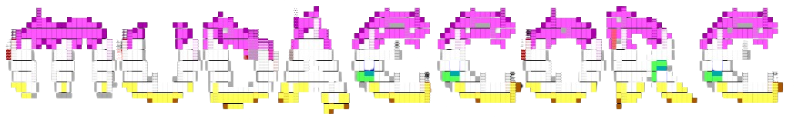
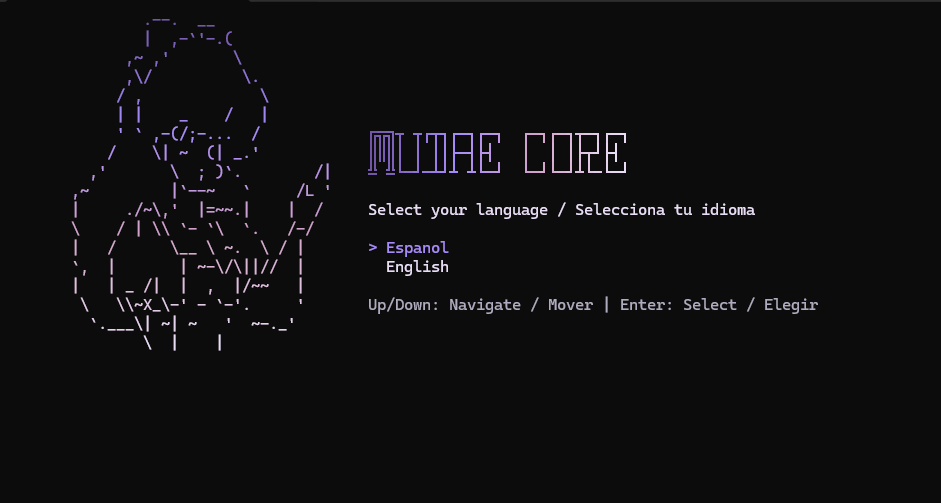

# 

*Character Tracking · Kakera Management · Wishlist Support · Custom Presets*

---

## 〢 💭 What is MudaeCore?

**MudaeCore** is an automated Mudae companion for Discord, designed to help users organize character preferences, monitor rolls and claim availability, track Kakera-related activity, and manage multiple configuration profiles.

It brings together character and series wishlists, customizable thresholds, configurable settings, and real-time activity monitoring in a single terminal-based experience.

> **Disclaimer:** MudaeCore is an independent community project and is not affiliated with, endorsed by, or officially authorized by Discord or Mudae. Automated user accounts may violate Discord's Terms of Service.

## 〢 ✨ Features

- **Character Tracking** — Monitor character-related activity and preferences.
- **Kakera Management** — Configure Kakera thresholds and review related activity.
- **Roll Monitoring** — View available rolls and reset information.
- **Wishlist Support** — Organize preferred characters and series.
- **Custom Presets** — Maintain independent configuration profiles.
- **Multiple Profiles** — Manage different profiles from the terminal menu.
- **Activity Logs** — Follow events through organized, color-coded messages.
- **Bilingual Interface** — English and Spanish support.

---

**MUDAECORE** · *Your Mudae experience, under one command.* ✦

